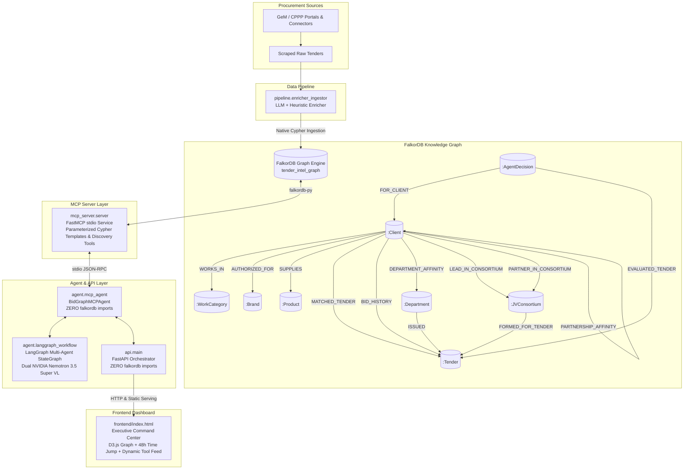
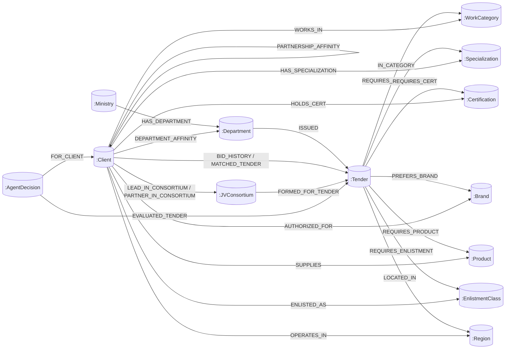

# BidGraphAI ⚡️
### Indian Tender Intelligence Engine Powered by FalkorDB & Model Context Protocol (MCP)

[](https://falkordb.com/)
[](https://modelcontextprotocol.io/)
[](https://fastapi.tiangolo.com/)
[](https://d3js.org/)
[](./tests)
[](#strict-mcp-boundary--zero-driver-architecture)

> **BidGraphAI** is an autonomous tender matching and consortium intelligence engine built for India's public procurement ecosystem (estimated at over ₹10 Lakh Crore across GeM and central portals).  
> It replaces brittle keyword searches and flat relational filters with **native FalkorDB OpenCypher multi-hop graph traversals**, **parameterized Cypher template tools**, **5-hop lookalike peer discovery**, **Joint Venture (JV) consortium matching**, and **adaptive outcome-driven weight updates** exposed strictly via the **Model Context Protocol (FastMCP)**.

---

## 🏆 Hackathon Tracks Alignment

BidGraphAI is architected from the ground up to address all 3 tracks of the **FalkorDB Hackathon**:

| Hackathon Track | How BidGraphAI Solves It with FalkorDB | Key Feature / Verification |
| :--- | :--- | :--- |
| **Track 1: Agents That Act on Connected Data** | A deterministic LangGraph workflow invokes parameterized MCP tools that use FalkorDB traversals for eligibility, historical-winner lookalikes, and JV candidate synthesis. The orchestration order is configured in code; the language model may summarize returned graph evidence but does not dynamically plan the tool sequence. | `discover_direct_and_lookalike_matches`, `check_client_coverage`, `find_peer_clients`, `explore_paths`, and `discover_jv_consortium_matches`. |
| **Track 2: Agent Memory and Coordination** | Outcome feedback persists on graph relationships and updates department/category affinity weights. This is application-level persistent state and feedback learning; it is not a full episodic conversation-memory system. | `record_bid_outcome_and_learn`, `record_jv_outcome_and_learn`, and the alert cooldown. |

---

## 🏛️ System Architecture



## 🕸️ Graph Map: Where Match Decisions Come From

FalkorDB is the source of tender requirements, contractor capabilities, regional eligibility, prior outcomes, and persisted consortium recommendations. The agent does not decide eligibility from a prompt alone: it asks the graph tools for connected evidence, applies the configured coverage and financial gates, then uses the language model to explain the result.



### How the agent reads the graph

1. `get_active_tenders_and_sync_status` reads active `Tender` nodes and their connected requirement and location nodes from FalkorDB.
2. `get_tender_requirements` reads a tender's categories, specializations, certifications, strict brand requirements, products, enlistment classes, and financial thresholds.
3. `discover_direct_and_lookalike_matches` traverses from the tender requirements to eligible clients. `check_client_coverage` returns the graph evidence behind a client's met and unmet requirements.
4. `discover_jv_consortium_matches` reads clients operating in the tender's region, collects their graph-linked capabilities and qualifications, then checks client pairs. A pair is returned only if neither client qualifies alone, the combined financials pass, and the union of their linked capabilities covers the tender requirements.
5. The workflow persists JV recommendations and agent decisions back to FalkorDB. The LLM produces the human-readable strategy from those returned records; it does not invent the underlying graph relationships or eligibility evidence.

The core JV path looks like this: **Tender → required capability nodes ← Client A**, plus **Tender → other required capability nodes ← Client B**. FalkorDB supplies both connected evidence sets; the matcher checks their union and the combined financial gates.

For a read-only view of the demo tender's graph requirements, use the graph explorer or MCP read-only Cypher tool:

```cypher
MATCH (t:Tender {id: 'RW/NH-12014/ 04/2025-MAH/ZONE-IV'})
RETURN t.id AS tender_id,
       t.expected_turnover_3yr AS required_turnover,
       [(t)-[:LOCATED_IN]->(r:Region) | r.name] AS regions,
       [(t)-[:IN_CATEGORY]->(n:WorkCategory) | n.name] AS categories,
       [(t)-[:REQUIRES_SPECIALIZATION]->(n:Specialization) | n.name] AS specializations,
       [(t)-[:REQUIRES_CERT]->(n:Certification) | n.name] AS certifications,
       [(t)-[:REQUIRES_ENLISTMENT]->(n:EnlistmentClass) | n.code] AS enlistments,
       [(t)-[e:PREFERS_BRAND]->(n:Brand) WHERE e.strict_auth_required = true | n.name] AS strict_brands
```

## 🎬 Demo: Show a Graph-Grounded JV Match

The JV benchmark uses four explicitly synthetic clients: two civil profiles and two electrical profiles. Their graph links are complementary, and each civil–electrical pair clears the seeded tender's configured combined financial thresholds. These records are labeled `SYNTHETIC_DEMO`; their demo credentials and regional flags are not externally verified.

Example evidence for **Northstar Civil Works + Voltcraft Power Systems**:

| Evidence read from FalkorDB | Civil partner | Electrical partner | Combined / tender gate |
| :--- | :--- | :--- | :--- |
| Work category | Civil Works | Electrical | Both required categories covered |
| Specialization | Civil Contractor | Wire Manufacturing Facility | Both required specializations covered |
| Credentials | BIS IS-7098, CPWD, IS 1786; CPWD Class I | BIS IS-7098; Havells authorization | Required certification, enlistment, and strict brand authorization covered |
| Average 3-year turnover | ₹15 Cr | ₹15 Cr | ₹30 Cr combined vs ₹28 Cr required |
| Net worth | ₹2.5 Cr | ₹2.5 Cr | ₹5 Cr combined vs ₹3 Cr required |
| Solvency | ₹3 Cr | ₹3 Cr | ₹6 Cr combined vs ₹4 Cr required |
| Technical staff | 24 | 24 | 48 combined vs 10 required |
| Ongoing work | ₹1 Cr | ₹1 Cr | ₹2 Cr combined vs ₹2.86 Cr maximum |

The dashboard's JV decision tree is therefore explainable from specific graph edges and node properties: the civil node contributes civil credentials, the electrical node contributes electrical and brand coverage, and FalkorDB-backed matching verifies the financial and regional gates.

### First-time local demo

From the repository root, start FalkorDB and seed the benchmark graph using the [Quickstart](#-quickstart-guide). The seeder includes the four synthetic JV profiles and their tender requirement edges.

### Existing persistent or deployed graph

After deploying the updated code, run this additive backfill from a shell that has the same FalkorDB connection settings and graph name as the app:

```bash
python db/seed_graph.py --jv-demo-only
```

This upserts the JV demo profiles and graph relationships without clearing the graph or deleting learned outcomes. Then:

1. Open the dashboard and click **Refresh Tenders**.
2. Click **Run AI Tender Matching**.
3. Open the JV Consortiums panel and select a result. The decision details show the client pair, combined financials, capability union, and regional gate.
4. Use the graph explorer to follow the client-to-capability and tender-to-requirement edges shown in the graph map above.

The seeded tender must still be active and before its deadline. If the JV count remains zero, inspect the MCP tool trace for `discover_jv_consortium_matches` and verify that the target tender is active, its requirement edges exist, and all four `client_demo_*` nodes appear in the selected FalkorDB graph.

---

## 🔒 Strict MCP Boundary & Zero-Driver Architecture

A core design rule of BidGraphAI is that **neither the agent layer (`agent/`) nor the API layer (`api/`) ever imports `falkordb` or database connection singletons directly**. 

All database interactions execute over the **official Model Context Protocol (`mcp`)** using `mcp.client.stdio.stdio_client` and `mcp.client.session.ClientSession`.

```bash
# Automated AST verification enforces this rule across all code
pytest -k test_phase3_preserves_zero_driver_ast_isolation
pytest -k test_phase4_preserves_strict_zero_driver_ast_isolation
```

---

## 🧠 Parameterized Cypher Tools & Deterministic Orchestration

### Why Parameterized Templates for Hackathon AI Agents?
Rather than having an LLM invent unpredictable, unconstrained raw Cypher strings at runtime, BidGraphAI models graph queries as **hardcoded, parameterized Cypher templates exposed as discrete MCP tools**:
1. **Submission Query Enumeration:** Hackathon judging requires an explicit, audited list of Cypher queries the product relies on.
2. **Auditable decisions:** Matching and coverage results include returned capability evidence and heuristic score components.
3. **Configured tool sequence:** The LangGraph workflow calls the registered MCP tools in a known sequence with conditional steps; an LLM does not choose the plan.
4. **Controlled queries:** The core matching tools use parameterized Cypher templates. This reduces query-generation errors, but does not by itself guarantee zero hallucinations or eliminate every security risk.

The displayed fit score is a deterministic heuristic ranking signal, not a calibrated probability of winning a tender. Contractor benchmark profiles and some enrichment fields are synthetic or inferred; verify eligibility against the source notice and current credentials.

### The 5 Core Parameterized Cypher Template Tools:

#### 1. `get_tender_requirements(tender_id)`
Fetches statutory, technical, OEM brand, and regional requirement nodes:
```cypher
MATCH (t:Tender {id: $tender_id})
OPTIONAL MATCH (d:Department)-[:ISSUED]->(t)
OPTIONAL MATCH (m:Ministry)-[:HAS_DEPARTMENT]->(d)
OPTIONAL MATCH (t)-[:LOCATED_IN]->(r:Region)
RETURN t.id AS id, t.title AS title, t.expected_turnover_3yr AS expected_turnover,
       d.id AS department_id, d.name AS department_name, m.name AS ministry_name,
       [(t)-[:IN_CATEGORY]->(wc:WorkCategory) | wc.name] AS work_categories,
       [(t)-[:REQUIRES_CERT]->(c:Certification) | c.name] AS certifications,
       [(t)-[:PREFERS_BRAND]->(b:Brand) | b.name] AS preferred_brands,
       [(t)-[:REQUIRES_PRODUCT]->(p:Product) | p.name] AS required_products
```

#### 2. `check_client_coverage(client_id, tender_id)`
Evaluates met vs unmet statutory and capability nodes for an individual bidder:
```cypher
MATCH (t:Tender {id: $tender_id})
MATCH (c:Client {id: $client_id})
OPTIONAL MATCH (t)-[:LOCATED_IN]->(tr:Region)<-[op:OPERATES_IN]-(c)
WITH t, c, op,
     [(t)-[:IN_CATEGORY]->(wc:WorkCategory) | wc.name] AS t_cats,
     [(c)-[:WORKS_IN]->(wc:WorkCategory) | wc.name] AS c_cats,
     [(t)-[:PREFERS_BRAND]->(b:Brand) | b.name] AS t_brands,
     [(c)-[:AUTHORIZED_FOR]->(b:Brand) | b.name] AS c_brands,
     [(t)-[:REQUIRES_CERT]->(cert:Certification) | cert.name] AS t_certs,
     [(c)-[:HOLDS_CERT]->(cert:Certification) | cert.name] AS c_certs,
     [(t)-[:REQUIRES_PRODUCT]->(p:Product) | p.name] AS t_prods,
     [(c)-[:SUPPLIES]->(p:Product) | p.name] AS c_prods
RETURN c.id, c.name, c.avg_turnover_3yr, t.expected_turnover_3yr,
       c.is_msme, c.is_blacklisted, op.gst_valid,
       [x IN t_cats WHERE x IN c_cats] AS met_categories,
       [x IN t_cats WHERE NOT x IN c_cats] AS unmet_categories,
       [x IN t_brands WHERE x IN c_brands] AS met_brands,
       [x IN t_brands WHERE NOT x IN c_brands] AS unmet_brands,
       [x IN t_certs WHERE x IN c_certs] AS met_certs,
       [x IN t_certs WHERE NOT x IN c_certs] AS unmet_certs,
       [x IN t_prods WHERE x IN c_prods] AS met_products,
       [x IN t_prods WHERE NOT x IN c_prods] AS unmet_products
```

#### 3. `get_department_lineage(client_id, department_id)`
Queries the client's past win-rate and learned affinity in the procuring department:
```cypher
MATCH (c:Client {id: $client_id})
MATCH (d:Department {id: $department_id})
OPTIONAL MATCH (c)-[da:DEPARTMENT_AFFINITY]->(d)
OPTIONAL MATCH (c)-[bh:BID_HISTORY]->(past_t:Tender)<-[:ISSUED]-(d)
RETURN d.id, d.name, coalesce(da.wins, 0), coalesce(da.win_rate, 0.0), count(bh) AS total_past_bids
```

#### 4. `find_peer_clients(client_id, tender_id)`
5-Hop OpenCypher lookalike peer traversal discovering structurally similar contractors who won past tenders under the same procuring department. Enforces `(peer, anchor)` grouping with $\ge 2$ shared capabilities per anchor, $\ge 2$ distinct supporting anchors, same work category constraint on past contracts, and privacy-shielded generic benchmark output:
```cypher
MATCH (t:Tender {id: $tender_id})-[:IN_CATEGORY]->(wc:WorkCategory)
MATCH (t)<-[:ISSUED]-(d:Department)-[:ISSUED]->(past_t:Tender)-[:IN_CATEGORY]->(wc)
MATCH (anchor:Client)-[:BID_HISTORY {outcome: 'WON'}]->(past_t)
WHERE anchor.is_blacklisted = false

MATCH (peer:Client)
WHERE ($client_id IS NULL OR $client_id = '' OR peer.id = $client_id)
  AND peer.id <> anchor.id AND peer.is_blacklisted = false
  AND (peer.avg_turnover_3yr >= coalesce(t.expected_turnover_3yr, 0) OR (peer.is_msme = true AND t.msme_exempt_turnover = true))
  AND NOT (peer)-[:BID_HISTORY]->(:Tender)<-[:ISSUED]-(d)

MATCH (t)-[:LOCATED_IN]->(r:Region)
MATCH (peer)-[op:OPERATES_IN]->(r) WHERE op.gst_valid = true
MATCH (peer)-[:WORKS_IN]->(wc)

// Group by (peer, anchor): require >= 2 shared capabilities per anchor
MATCH (anchor)-[:WORKS_IN|HAS_SPECIALIZATION|HOLDS_CERT|AUTHORIZED_FOR|SUPPLIES]->(shared)<-[:WORKS_IN|HAS_SPECIALIZATION|HOLDS_CERT|AUTHORIZED_FOR|SUPPLIES]-(peer)
WITH peer, anchor, count(DISTINCT shared) AS shared_per_anchor
WHERE shared_per_anchor >= 2

// Group by peer: require >= 2 distinct supporting anchors
WITH peer, count(DISTINCT anchor) AS supporting_anchors, sum(shared_per_anchor) AS total_shared_caps
WHERE supporting_anchors >= 2

WITH peer, supporting_anchors, total_shared_caps,
     (0.68 + 0.15 * (CASE WHEN supporting_anchors >= 3 THEN 1.0 ELSE 0.6 END)) AS raw_score

RETURN peer.id AS peer_client_id, peer.name AS peer_name,
       "[Generic Peer Benchmark - Identity Shielded]" AS benchmark_reference,
       supporting_anchors, total_shared_caps,
       round((CASE WHEN raw_score > 0.92 THEN 0.92 ELSE raw_score END) * 10000.0) / 10000.0 AS match_score
```

#### 5. `explore_paths(spec_json)`
Constrained shortest path graph exploration with strict server-side label whitelist (`ALLOWED_LABELS`), directed traversal, and privacy filter excluding competitor bid histories:
```cypher
MATCH (s), (t)
WHERE any(l IN labels(s) WHERE l = $start_type)
  AND any(l IN labels(t) WHERE l = $target_type)
  AND $start_id IN [s.id, s.name, s.code]
  AND $target_id IN [t.id, t.name, t.code]
WITH s, t
WITH shortestPath((s)-[*..3]->(t)) AS path_fwd, shortestPath((t)-[*..3]->(s)) AS path_rev
WITH coalesce(path_fwd, path_rev) AS path
WHERE path IS NOT NULL
  AND NONE(r IN relationships(path) WHERE type(r) IN ['BID_HISTORY', 'MATCHED_TENDER'])
RETURN [n IN nodes(path) | {id: coalesce(n.id, n.name, n.code), label: labels(n)[0]}] AS path_nodes,
       [r IN relationships(path) | type(r)] AS path_relationships
LIMIT 5
```

---

## 💡 Key Graph Traversals & Algorithmic Capabilities

### 1. Historical-Winner Lookalike Signal & Privacy Shield
The query compares eligible clients' connected capability nodes with clients that won past tenders in the same department and category. The returned lookalike signal contains anchor counts and shared-capability counts; anchor identities and past tender IDs are withheld. It is a fit signal, not a win prediction.

### 2. Joint Venture (JV) Consortium Hub & 5-Stage Decision Tree
If a tender requires multi-disciplinary capabilities (e.g. Civil + Electrical) or higher turnover than any single contractor holds, BidGraphAI forms complementary consortia and calculates lead/partner shares from their turnover. Each pair is evaluated across a 5-stage decision gate:
- **Stage 1:** Solo Disqualification Gate
- **Stage 2:** Financial Aggregation Gate (Combined turnover >= tender statutory threshold)
- **Stage 3:** Capability Union Gate (Union covers 100% of categories, brands, certs)
- **Stage 4:** Regional Compliance Gate (valid regional graph flag & no blacklist flag)
- **Stage 5:** Governance Recommendation (lead and partner roles with calculated equity shares)

### 3. 48-Hour Alert Cooldown Enforcement
Prevents repeat alerts by storing and checking a 172,800-second cooldown on `[:MATCHED_TENDER]` edges:
```cypher
MATCH (c:Client {id: $client_id})-[r:MATCHED_TENDER]->(t:Tender {id: $tender_id})
WHERE r.status IN ['WON', 'LOST']
   OR (r.status = 'ALERTED' AND ($now - r.last_alert_sent) < 172800)
RETURN r.status AS status, r.last_alert_sent AS last_alert_sent, (172800 - ($now - r.last_alert_sent)) AS seconds_remaining
```

## 🚀 Quickstart Guide

> 📖 **For complete step-by-step onboarding, configuration, and verification instructions, see [quickstart.md](quickstart.md).**

### Option 1: Docker Compose (Recommended)

Run FalkorDB and the entire BidGraphAI web service in one command:

```bash
docker compose up --build
```
Open **[http://localhost:8000](http://localhost:8000)** in your browser.

---

### Option 2: Local Python 3.11+ Installation

#### 1. Start FalkorDB
```bash
docker run -p 6379:6379 -it --rm falkordb/falkordb:latest
```

#### 2. Install Dependencies
```bash
python3 -m venv venv
source venv/bin/activate
pip install -r requirements.txt
```

#### 3. Seed Benchmark Graph & Launch Server
```bash
# Seed the initial benchmark dataset into FalkorDB
python -m db.seed_graph

# Launch the FastAPI orchestrator and Executive Dashboard
uvicorn api.main:app --host 0.0.0.0 --port 8000
```
Open **[http://localhost:8000](http://localhost:8000)**.

---

## 🧪 Comprehensive Pytest Verification Suite

BidGraphAI includes complete automated verification across all 7 architectural test suites:

```bash
pytest -v tests/
```

### Test Results Breakdown:
- **Rule 12 & Cypher Integrity Verification (`test_rule12_and_cypher_integrity.py` - 9 Tests)**
  - `test_readme_cypher_queries_syntax_and_execution`
  - `test_laplace_smoothed_learning_and_double_click_idempotency`
  - `test_lookalike_peer_alert_and_email_zero_anchor_leakage`
  - `test_pattern_f_explore_paths_syntax_and_whitelist`
  - `test_pattern_d_tenders_without_department_handling`
  - `test_pattern_a_credential_gating_rejects_missing_credentials`
  - `test_pattern_a_and_c_null_requirements_do_not_drop_qualifying_clients`
  - `test_pattern_f_explore_paths_privacy_shield_blocks_competitor_edges`
  - `test_pattern_b_lookalike_peer_eligibility_and_cooldown_gating`
- **Email Alerting & Redaction (`test_email_alerting_hackathon.py` - 4 Tests)**
  - `test_all_clients_have_hackathon_demo_email`
  - `test_send_single_alert_endpoint_payload`
  - `test_lookalike_privacy_shield_never_reveals_peer`
  - `test_batch_alert_send_endpoint`
- **Phase 1: FalkorDB Engine & MCP FastMCP Server (`test_phase1_mcp_and_graph.py` - 7 Tests)**
  - `test_schema_and_seeding`
  - `test_enricher_and_sync_heartbeat`
  - `test_direct_and_5hop_lookalike_matching`
  - `test_jv_consortium_discovery`
  - `test_two_day_alert_cooldown_enforcement`
  - `test_won_lost_feedback_and_agent_learning_loop`
  - `test_execute_read_cypher_diagnostic`
- **Phase 2: Strict MCP Client, Agent Loop & API Endpoints (`test_phase2_agent_and_api.py` - 6 Tests)**
  - `test_zero_falkordb_imports_in_agent_and_api` (AST check)
  - `test_mcp_client_handshake_and_tool_discovery`
  - `test_pull_tenders_button_endpoint`
  - `test_agent_matching_loop_and_48h_cooldown_via_api`
  - `test_won_lost_buttons_update_affinity_and_halt_alerts_via_api`
  - `test_privacy_shield_lookalike_peer_alert_anonymity`
- **Phase 3: Frontend Serving, Complete E2E Journey & Time Jump (`test_phase3_ui_and_e2e_workflow.py` - 5 Tests)**
  - `test_frontend_ui_served_and_assets_load`
  - `test_reset_and_seed_demo_via_mcp_endpoint`
  - `test_enrich_and_ingest_new_tender_via_api_and_pull`
  - `test_full_e2e_judge_demo_flow_with_time_jump_and_learning`
  - `test_phase3_preserves_zero_driver_ast_isolation`
- **Phase 4: JV Consortium Hub, 5-Stage Decision Tree & LangGraph Agent (`test_phase4_jv_and_langgraph.py` - 5 Tests)**
  - `test_phase4_preserves_strict_zero_driver_ast_isolation`
  - `test_tender_estimated_values_populated_and_positive`
  - `test_jv_consortium_graph_persistence_and_decision_tree`
  - `test_jv_outcome_learning_loop`
  - `test_langgraph_agentic_workflow_execution`
- **Phase 5: Multi-Channel Communication Agent & Privacy Shield (`test_phase5_communication_agent.py` - 6 Tests)**
  - `test_zero_direct_db_imports_in_communication_agent` (AST check)
  - `test_communication_agent_model_target`
  - `test_email_draft_with_unconfigured_and_configured_client_email`
  - `test_api_draft_email_endpoint`
  - `test_api_draft_all_emails_endpoint`
  - `test_peer_email_redacts_anchor_identity_and_contracts`

---

## 🎮 Walkthrough

Follow this 2-minute walkthrough on **[https://graphhacks-bidgraphai.onrender.com/]**:

1. **Pull Active Tenders:** Click **"Refresh Tenders"** (top utility bar) to fetch active procurement opportunities from FalkorDB via FastMCP.
2. **Run AI Tender Matching:** Click **"Run AI Tender Matching"** (hero gradient button). Notice how the autonomous dual-agent system matches:
   - Direct 1-hop matches for `Surya Wire & Switchgear`.
   - 5-Hop Lookalike peers for `Apex Electricals`.
   - High-synergy Joint Venture (JV) Consortium pair for `Kaveri Civil` + `Surya Wire`.
3. **Inspect Agent Reasoning:** Read the graph-grounded reasoning traces explaining turnover calculations, OEM brand authorization validity, and GST territorial compliance.
4. **Test Cooldown Enforcement:** Click **"Run AI Tender Matching"** a second time. The FalkorDB engine blocks duplicate alerts because 48 hours have not elapsed.
5. **Test +48h Time-Jump Simulator:** Click **"+48h Time Jump"** in the top navigation bar. Run the loop again—cooldowns have expired and alerts re-dispatch!
6. **Trigger the Memory Learning Loop:** Click **"Won"** on the alert for `Surya Wire`. Notice the **Learned Affinities Leaderboard** immediately updates the win rate and affinity weight for NTPC Karnataka Region.
7. **Verify Terminal State Protection:** Trigger the matching loop once more—the tender marked "Won" is never re-alerted, respecting terminal contract state.
8. **One-Click Demo Reset:** Click **"Reset"** to restore FalkorDB back to its pristine benchmark state via FastMCP.

---

## 👥 Authors & Acknowledgments

Built with ❤️ for the **GraphHacks Hackathon 2026** by the **Team Lightning_Blazers**.

### Contributors:
- **Harshith**: Created DB schema, Cypher commands, MCP server and tools, implemented AI agents
- **Akanksha**: Created Dockerfile, quickstart file, deployment file and deployed it to Render
- **AI**: Frontend, creating test cases and API implementation

