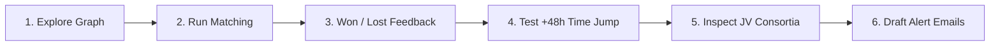

# BidGraphAI ⚡️ Quickstart Guide

> **Get BidGraphAI up and running in under 2 minutes.**  
> This guide walks anyone cloning this repository through spinning up the application, verifying the services, and testing the core AI graph capabilities.

---

## 📋 Table of Contents
1. [System Overview & Architecture](#-system-overview)
2. [Prerequisites](#-prerequisites)
3. [Option A: Docker Compose (Recommended — 1 Command)](#-option-a-docker-compose-recommended)
4. [Option B: Local Python 3.11+ Setup (Developer Mode)](#-option-b-local-python-311-setup-developer-mode)
5. [Database Schema Initialization & Tender Ingestion Lifecycle](#-database-schema-initialization--tender-ingestion-lifecycle)
6. [Application Endpoints & Verification](#-application-endpoints--verification)
7. [Interactive Feature Tour (What to Try First)](#-interactive-feature-tour-what-to-try-first)
8. [Running the Automated Test Suite (42/42 Tests)](#-running-the-automated-test-suite)
9. [Configuration & Environment Variables](#-configuration--environment-variables)
10. [Troubleshooting & FAQs](#-troubleshooting--faqs)

---

## 🏛️ System Overview

BidGraphAI is an autonomous tender matching and consortium intelligence engine built for India's public procurement ecosystem (GeM & CPPP). It uses:
- **FalkorDB** as the high-performance in-memory graph database running OpenCypher queries.
- **Model Context Protocol (FastMCP)** running over stdio JSON-RPC to expose discrete, parameterized Cypher templates to the agent layer with zero direct database driver imports.
- **FastAPI Backend & Embedded Command Center** serving both REST APIs and the interactive D3.js force-directed graph UI on a single unified port (`8000`).
- **Cognitive AI Synthesizers** (Dual NVIDIA Nemotron 3.5 & LangGraph) for multi-hop lookalike peer discovery, 5-stage Joint Venture (JV) consortium formation, and autonomous email alerting.

```
┌────────────────────────────────────────────────────────┐
│   Browser: Executive Command Center (Port 8000)        │
│   (HTML5 + Vanilla JS + TailwindCSS + D3.js v7 Graph)  │
└───────────────────────────┬────────────────────────────┘
                            │ HTTP REST / Static Serving
┌───────────────────────────▼────────────────────────────┐
│   FastAPI Orchestrator (api/main.py)                   │
│   ├── BidGraphMCPAgent (agent/mcp_agent.py)            │
│   └── LangGraph Workflow (agent/langgraph_workflow.py) │
└───────────────────────────┬────────────────────────────┘
                            │ stdio JSON-RPC (FastMCP)
┌───────────────────────────▼────────────────────────────┐
│   MCP Server Subsystem (mcp_server/server.py)          │
│   (Parameterized Cypher Template Tools)                │
└───────────────────────────┬────────────────────────────┘
                            │ Cypher / TCP (Port 6379)
┌───────────────────────────▼────────────────────────────┐
│   FalkorDB Graph Engine (falkordb:latest)              │
│   Database: tender_intel_graph                         │
└────────────────────────────────────────────────────────┘
```

---

## ⚙️ Prerequisites

Before you begin, ensure you have:

| Tool | Minimum Version | Required For |
| :--- | :--- | :--- |
| **Git** | 2.x+ | Cloning the repository |
| **Docker & Docker Compose** | Docker 20.10+ / Compose v2+ | **Option A** (Simplest 1-command startup) |
| **Python** | 3.11+ | **Option B** (Local native development) |

### 🔑 Optional API Keys (For Live AI Inference)
BidGraphAI runs fully deterministically out of the box with built-in heuristic graph logic. To enable live neural reasoning and personalized alert email drafting, obtain free API keys:
- **OpenRouter API Key** (for NVIDIA Nemotron 3.5 Super VL): [openrouter.ai](https://openrouter.ai)
- **Google Gemini API Key** (optional for email dispatch agent): [aistudio.google.com](https://aistudio.google.com)

---

## 🚀 Option A: Docker Compose (Recommended)

Docker Compose builds the web service and spins up FalkorDB together with automated health checks and dataset seeding.

### Step 1: Clone the Repository
```bash
git clone https://github.com/your-username/BidGraphAI.git
cd BidGraphAI
```

### Step 2: Initialize Environment Variables
Copy the sample environment file:
```bash
cp .env.example .env
```
*(Optional)* Open `.env` in any editor and insert your `OPENROUTER_API_KEY_ALPHA` if you want live NVIDIA Nemotron reasoning.

### Step 3: Spin Up Containers
```bash
docker compose up --build
```

### What happens automatically:
1. Docker pulls and boots the official `falkordb/falkordb:latest` container on port `6379`.
2. The healthcheck confirms FalkorDB is responding to `redis-cli ping`.
3. The `web` container builds Python 3.11, installs `requirements.txt`, and executes `start.sh`.
4. `start.sh` automatically seeds the benchmark dataset into FalkorDB (`AUTO_SEED=true`) with real GeM/CPPP tenders, Indian contractor profiles, and capability relationships.
5. The FastAPI server and D3.js dashboard launch on `0.0.0.0:8000`.

### Step 4: Open in Your Browser
Visit **[http://localhost:8000](http://localhost:8000)**.

To stop the containers when finished:
```bash
docker compose down
```
*(To wipe the database volume cleanly on shutdown, add `-v`: `docker compose down -v`)*

---

## 💻 Option B: Local Python 3.11+ Setup (Developer Mode)

Use this method if you want to actively edit Python code or run unit tests directly on your host machine.

### Step 1: Clone the Repository
```bash
git clone https://github.com/your-username/BidGraphAI.git
cd BidGraphAI
```

### Step 2: Start a FalkorDB Instance
Choose either local Docker or free cloud hosting:

**Option 2.1: Run FalkorDB via Docker (Easiest)**
```bash
docker run -d --name bidgraph-falkordb -p 6379:6379 falkordb/falkordb:latest
```

**Option 2.2: Use FalkorDB Cloud (No local Docker needed)**
1. Create a free database at [FalkorDB Cloud Console](https://app.falkordb.cloud).
2. Note your host, port, password, and enable SSL.

### Step 3: Create & Activate Virtual Environment
```bash
# Create virtual environment
python3 -m venv venv

# Activate on macOS/Linux:
source venv/bin/activate

# Or activate on Windows (PowerShell):
# .\venv\Scripts\Activate.ps1
```

### Step 4: Install Dependencies
```bash
pip install --upgrade pip
pip install -r requirements.txt
```

### Step 5: Configure Environment File
```bash
cp .env.example .env
```
Edit `.env` as needed:
- If using local FalkorDB Docker: keep `FALKORDB_HOST=localhost` and `FALKORDB_PORT=6379`.
- If using FalkorDB Cloud: set `FALKORDB_HOST=your-instance.falkordb.cloud`, `FALKORDB_PASSWORD=your_password`, and `FALKORDB_SSL=true`.
- *(Optional)* Add your `OPENROUTER_API_KEY_ALPHA` for NVIDIA Nemotron 3.5.

### Step 6: Seed Benchmark Knowledge Graph
Run the database seed script to populate the graph with real Indian government tenders, departments, and 12 synthetic contractor clients:
```bash
python -m db.seed_graph
```
*Output should show:* `Graph initialization completed successfully.`

### Step 7: Launch FastAPI Server & Command Center
```bash
uvicorn api.main:app --host 0.0.0.0 --port 8000 --reload
```
Open **[http://localhost:8000](http://localhost:8000)** in your browser.

---

## 🔄 Database Schema Initialization & Tender Ingestion Lifecycle

### 1. How Database Schema & Indexes Are Implemented
When you spin up FalkorDB (via Docker image `falkordb/falkordb:latest` or FalkorDB Cloud), it starts as an in-memory graph engine ready to accept OpenCypher queries on port `6379`.

All schema indexes and constraints are defined centrally in `db/schema.py`:
- 15 high-cardinality indexes are created across core node types:
  `Tender.id`, `Tender.status`, `Client.id`, `Client.is_blacklisted`, `WorkCategory.name`, `Specialization.name`, `Certification.name`, `Brand.name`, `Product.name`, `EnlistmentClass.code`, `Region.name`, `Department.id`, `Ministry.id`, `AgentDecision.id`, and `SystemMeta.key`.
- **Automatic Execution:** When running Docker Compose or running `python -m db.seed_graph`, `initialize_schema(graph)` is called automatically and idempotently (skipping existing indexes cleanly without errors).
- **Standalone Schema Setup (Indexes only, without benchmark seeding):**
  If you want to apply all indexes to a blank FalkorDB instance without populating demo data:
  ```bash
  python -c "from db.connection import get_graph; from db.schema import initialize_schema; print(initialize_schema(get_graph()))"
  ```

---

### 2. Tender Ingestion & Pipeline Execution
Once the schema is in place, you can ingest real or synthetic Indian procurement tenders into FalkorDB through three methods:

#### Method 1: 1-Click Ingestion via Executive Dashboard
- Open **`http://localhost:8000`** in your browser.
- Click **`+ Ingest Live Tenders`** in the header.
- The system scrapes active GeM & CPPP tender listings, enriches trade, BOQ, and turnover criteria, and upserts them into FalkorDB via MCP.
- Telemetry counter (`Tenders Ingested`) updates in real-time.

#### Method 2: CLI Ingestion / Scraper Cron Runner (`pipeline/cron_runner.py`)
BidGraphAI includes a dedicated scraper & ingestion CLI:
```bash
# Ingest local sample tenders from JSON/JSONL file:
python -m pipeline.cron_runner --once --sample-file data/tenders.jsonl

# Trigger live scraping from GeM (Government e-Marketplace) and ingest:
python -m pipeline.cron_runner --once --scrape --portal gem --limit 10

# Trigger live scraping from CPPP (Central Public Procurement Portal):
python -m pipeline.cron_runner --once --scrape --portal cppp --limit 10

# Run a persistent hourly background cron ingestion loop:
python -m pipeline.cron_runner --interval-minutes 60
```

#### Method 3: REST API Ingestion Endpoint
You can programmatically ingest raw or structured tender payloads using the REST API:
```bash
curl -X POST http://localhost:8000/api/pipeline/enrich-and-ingest \
  -H "Content-Type: application/json" \
  -d '{
    "id": "GEM-2026-CUSTOM-001",
    "title": "Supply and Installation of 11kV Substation Transformers",
    "ministry_name": "Ministry of Power",
    "tender_amount": 15000000.0,
    "raw_location": "Bengaluru, Karnataka",
    "description": "BIS certified 11kV step-down transformers and Schneider switchgear."
  }'
```

#### Ingestion Lifecycle Breakdown:
1. **Raw Scrape / Payload:** Portal metadata (reference number, title, authority, location, BOQ) is received.
2. **Enrichment (`pipeline/enricher_ingestor.py`):** Extracts required certifications, brand authorizations, work categories, and financial turnover thresholds using LLM / heuristic rules.
3. **Graph Upsert via OpenCypher:** Merges `:Tender`, `:Department`, `:Ministry`, `:WorkCategory`, `:Brand`, `:Product`, and `:Region` nodes and creates directed relationships (`:IN_CATEGORY`, `:PREFERS_BRAND`, `:REQUIRES_CERT`, `:LOCATED_IN`).
4. **Heartbeat Update:** Updates `(:SystemMeta {key: 'scraper_status'})` with timestamp and ingested tender count.

---

## 🌐 Application Endpoints & Verification

Once running, you can access the following interfaces:

| Interface / Endpoint | URL | Purpose |
| :--- | :--- | :--- |
| **Executive Command Center** | `http://localhost:8000/` | Main web UI with D3.js Force-Directed Graph, AI matching loop, and email dispatch. |
| **Interactive Swagger Docs** | `http://localhost:8000/docs` | Live OpenAPI test console for all REST endpoints. |
| **ReDoc Specification** | `http://localhost:8000/redoc` | Formatted API documentation. |
| **MCP System Health Check** | `http://localhost:8000/api/health` | Verifies live MCP tool registration and database connectivity. |
| **Live Dashboard State** | `http://localhost:8000/api/dashboard` | Returns current scraper telemetry, graph nodes/edges, and active alerts. |

### Quick CLI Health Verification:
```bash
curl -s http://localhost:8000/api/health | jq .
```
Expected response:
```json
{
  "status": "ok",
  "engine": "FalkorDB via MCP",
  "protocol": "Model Context Protocol (FastMCP)",
  "mcp_tools_count": 12
}
```

---

## 🎯 Interactive Feature Tour (What to Try First)

Once you open **[http://localhost:8000](http://localhost:8000)**, here is the recommended 5-minute tour to experience all features:



### 1. Explore the D3.js Force-Directed Graph
- Scroll to the **Interactive Graph Topology Explorer**.
- Hover, drag, and click nodes:
  - 🔵 **Blue**: Contractors (`:Client`)
  - 🟢 **Emerald**: Active Tenders (`:Tender`)
  - 🟣 **Purple**: Procuring Departments (`:Department`)
  - 🟠 **Amber**: Work Categories & Technical Certifications
  - 🔴 **Rose**: Joint Venture Consortia (`:JVConsortium`)

### 2. Run the Autonomous AI Matching Loop
- Click the gradient button **`Run AI Tender Matching`** in the top navigation bar.
- The system will:
  - Fetch active tenders via the MCP tool `get_tender_requirements`.
  - Evaluate statutory eligibility, GST compliance, and financial turnover.
  - Traverse 5 hops to surface lookalike peer contractors.
  - Assemble complementary Joint Venture consortia for large multi-discipline bids.
  - Synthesize reasoning traces using NVIDIA Nemotron 3.5.

### 3. Test Adaptive Memory & Feedback Learning
- In the **Dispatched Tender Alerts** feed, locate an alert card.
- Click the **`Won`** or **`Lost`** button.
- Notice how the agent executes Laplace-smoothed updates on `:DEPARTMENT_AFFINITY` and `:CATEGORY_AFFINITY` edges. The learned affinity score updates instantly on screen.

### 4. Test the 48-Hour Alert Cooldown & Time-Jump Simulator
- Try running matching again immediately; notice that previously alerted tenders show a **Cooldown Active (2d)** badge to prevent alert fatigue.
- Click the **`+48h Time Jump`** button in the header to simulate advancing time past 172,800 seconds.
- Re-run matching to see the cooldown naturally expire.

### 5. Inspect the Joint Venture (JV) Consortium Hub
- Look at the **Joint Venture Consortia** section.
- View how multi-disciplinary civil + electrical tenders (e.g., AIIMS Hospital expansion) automatically pair an eligible 60% Lead contractor with a 40% Partner to pass all 5 gates (turnover union, capability union, GST compliance).

### 6. Generate AI Alert Emails & Safe Outbox
- Click **`Draft All Alert Emails`** to trigger the AI Communication Agent.
- Review drafted executive alerts tailored to each contractor's specific strengths with competitor identities strictly privacy-shielded.
- Dispatched emails route safely to `hackathon-demo@outlook.com` or safe simulated outbox logging.

### 7. Reset the Benchmark State
- Click the **`Reset`** button (or call `POST /api/demo/reset`) at any time to return the graph to its clean baseline state.

---

## 🧪 Running the Automated Test Suite

BidGraphAI features a comprehensive Pytest test suite covering all architectural phases:

```bash
# Ensure virtual environment is active
source venv/bin/activate

# Run all 42 automated tests
pytest -v tests/
```

### Key Subsystem Verifications:
```bash
# 1. Verify strict zero-driver AST isolation (Agent & API never import falkordb)
pytest -v -k "zero_driver"

# 2. Verify OpenCypher templates & Laplace-smoothed memory updates
pytest -v tests/test_rule12_and_cypher_integrity.py

# 3. Verify Lookalike peer privacy shields & email alerts
pytest -v tests/test_email_alerting_hackathon.py

# 4. Verify FastMCP stdio tool registration
pytest -v tests/test_phase1_mcp_and_graph.py

# 5. Verify 5-stage Joint Venture decision tree
pytest -v tests/test_phase4_jv_and_langgraph.py
```

---

## ⚙️ Configuration & Environment Variables

All settings are configured via `.env` and managed cleanly by `config.py`:

| Variable | Default Value | Description |
| :--- | :--- | :--- |
| `FALKORDB_HOST` | `localhost` | FalkorDB hostname (use `falkordb` inside Docker Compose network). |
| `FALKORDB_PORT` | `6379` | FalkorDB port. |
| `FALKORDB_PASSWORD` | `""` | Database password (required for FalkorDB Cloud). |
| `FALKORDB_SSL` | `false` | Enable TLS encryption (set `true` for FalkorDB Cloud). |
| `FALKORDB_GRAPH_NAME`| `tender_intel_graph`| Target graph name in FalkorDB. |
| `AUTO_SEED` | `true` | Automatically seeds initial benchmark graph on server boot if empty. |
| `OPENROUTER_MODEL` | `nvidia/nemotron-3.5-super-vl:free` | Reasoning model for autonomous multi-agent synthesis. |
| `OPENROUTER_API_KEY_ALPHA` | `""` | Primary API key for OpenRouter / Nemotron. |
| `OPENROUTER_API_KEY_BETA` | `""` | Secondary failover key for OpenRouter. |
| `GEMINI_API_KEY` | `""` | Optional Google Gemini key for communication drafting. |
| `DEFAULT_ALERT_EMAIL`| `hackathon-demo@outlook.com` | Standard recipient address for demo email dispatches. |
| `SMTP_HOST` | `""` | Optional SMTP server for real outbound delivery (leave blank for simulated dispatch). |
| `PORT` | `8000` | Port for the unified FastAPI and static dashboard server. |

---

## 🛠️ Troubleshooting & FAQs

### 1. `docker: connect: no such file or directory` / Docker Daemon Offline
- **Cause:** Docker Desktop / OrbStack / dockerd is not running.
- **Fix:** Launch your Docker desktop app or start the Docker daemon (`sudo systemctl start docker` on Linux), then re-run `docker compose up --build`.

### 2. `Address already in use: 6379` or `8000`
- **Cause:** Another Redis/FalkorDB instance or web server is occupying the port.
- **Fix:**
  - Check what is running on port 6379: `lsof -i :6379`
  - Check what is running on port 8000: `lsof -i :8000`
  - Stop any existing local Redis: `brew services stop redis` or `docker stop $(docker ps -q --filter ancestor=falkordb/falkordb:latest)`

### 3. Inspecting the Graph Directly via Redis CLI
You can query FalkorDB directly using the Redis CLI:
```bash
# If running via Docker Compose:
docker exec -it bidgraph-falkordb redis-cli GRAPH.QUERY tender_intel_graph "MATCH (n) RETURN labels(n)[0] AS label, count(n) AS count"

# If running via local standalone Docker:
docker exec -it bidgraph-falkordb redis-cli GRAPH.QUERY tender_intel_graph "MATCH (c:Client) RETURN c.id, c.name, c.avg_turnover_3yr"
```

### 4. What if I do not have an OpenRouter API Key?
BidGraphAI is built with graceful fallbacks:
- If no OpenRouter key is provided in `.env`, the system executes deterministic parameterized Cypher traversals, calculates mathematical eligibility scores, and generates structured heuristic reasoning traces.
- All graph traversals, lookalike peer discovery, and JV consortium gates function 100% without external API keys.

### 5. How do I re-seed or reset my database?
You have two simple options:
- **From the Web UI:** Click the **`Reset`** button in the top navigation bar.
- **From the CLI:** Run `python -m db.seed_graph` (in your activated virtual environment).

---

## ☁️ Cloud Deployment (Render)

Want to deploy to the cloud? BidGraphAI includes a native `render.yaml` blueprint.  
For complete instructions on deploying to Render paired with FalkorDB Cloud, see:  
📖 **[DEPLOYMENT_RENDER.md](DEPLOYMENT_RENDER.md)**

---

*BidGraphAI — Powered by [FalkorDB](https://falkordb.com/) & [Model Context Protocol](https://modelcontextprotocol.io/)*
